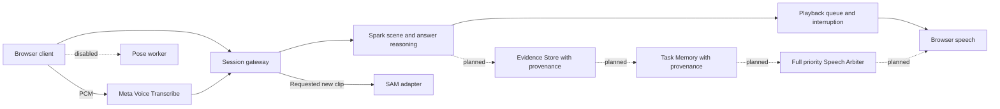

Glint helps people keep their hands on a task while asking for guidance about what is in front of them.

# Glint

**Meta Global AI Developer Hackathon 2026** · Solo: Parvathi Nalla
**Track:** Indie Developer
**Theme:** Build for Your World
Built during the hackathon, Oct 27–Nov 4, 2026. Repository created Oct 29, inside the event window; available commit history starts Oct 28. Asset provenance still requires review.

## Demo

[](https://youtu.be/LNRBw1rmBLQ)

[**▶ Watch the Glint demo on YouTube**](https://youtu.be/LNRBw1rmBLQ)

[Download the MP4](media/Glint-Demo.mp4)

## Problem

Cooking, assembly and crafts occupy your hands. Asking for help should not require repeatedly typing or describing the scene. Camera evidence is incomplete, however. Seeing a bowl tilt does not prove what was in it.

## What it does

- Ask a question by voice or text, with selected recent camera frames as context.
- Hear a short answer and interrupt or end the session using visible controls.
- Request a new object-movement clip when account access and object analysis are enabled.
- Keep user-reported task progress separate from proof of completion in the existing checkpoint workflow.

**Submission profile:** Meta Model API + browser speech. Partner-hosted generative inference and external TTS are not used by this profile, by choice. Local Silero VAD detects speech boundaries; pose inference is disabled. The normal development profile still contains experimental speech providers and image previews. Use the explicit commands below for the submission.

Full provenance memory is the core design, not a claim of complete shipped implementation. [Approved design](docs/GLINT_DESIGN_DOCUMENT.md) defines the five categories: observed, user-reported, inferred, source-derived and model-general.

## Meta models and runtime evidence

The adapters below connect Glint to Meta models. Automated tests cover the API paths; they do not establish live accuracy.

| Model ID | Job | Code | Endpoint |
| --- | --- | --- | --- |
| `muse-voice-transcribe-1.0` | Realtime speech transcription, with WAV recovery | [ASR adapter](backend/asr-provider.ts), [recovery adapter](backend/agent-provider.ts) | `wss://api.meta.ai/v1/asr/realtime`; `https://api.meta.ai/v1/asr/transcribe` |
| `sam-3.1` | Optional requested clip segmentation and camera-relative movement | [SAM adapter](backend/sam-provider.ts) | `https://api.meta.ai/v1/responses` |

**Conversation:** Glint sends your question, selected camera frames, and conversation context to the Meta Model API. The model connected through your account uses that information to respond to what you are asking about.

**Optional tools:** SAM supports short object-motion clips, while Muse Image supports requested image edits. These tools have implemented adapters and automated test coverage; that does not establish their accuracy in real-world use. They are separate from the main camera-and-voice conversation flow.

## Architecture

Solid arrows show current submission paths. Dashed components are approved design targets, not completed runtime stores or services.



The gateway relays transcription calls; the diagram's PCM edge is a logical data flow, not a direct browser key-bearing connection to Meta. SQLite stores opted-in task progress only. Sessions, conversation and active work are held in memory. Camera frames are selected on requests. Background camera checks are optional and off by default.

## Code layout

- `frontend/`: React/Vite client.
- `backend/`: Node server and Meta Model API adapters.
- `shared/`: types and contracts used by both.
- `tests/`: unit/integration and Playwright suites.

## Run Glint

Glint runs on a local Node server. During testing, we used **Cloudflare Tunnel** to open that server through an HTTPS link on phones and other devices. Cloudflare provides access to the running app; the server still runs on the laptop.

### Local development

Requires Node.js 24 and npm.

```bash
git clone https://github.com/parvathinalla/Glint.git
cd Glint
npm ci
npm run dev
```

Open [http://127.0.0.1:3100](http://127.0.0.1:3100). Connect your Meta Model API key through the app. For LiveKit speech, configure the LiveKit settings from [.env.example](.env.example) in an ignored `.env.local` file. Keep API keys out of GitHub.

### Phone testing with Cloudflare Tunnel

On Windows, with `cloudflared` installed, the included script builds Glint, starts the server, and creates a temporary HTTPS link:

```powershell
powershell -NoProfile -File scripts/start-monitored.ps1
```

Open the generated `https://…trycloudflare.com` link on your phone and allow camera/microphone access when you choose to use them. The link is recorded in `.data/managed/state.json`. Keep the laptop, server and tunnel running while testing. The link is temporary and can change on restart.

### Separate submission profile

`npm run dev:submission` starts the restricted submission profile: browser speech, pose inference disabled, and an optional labelled fixture replay. It differs from the regular app used for LiveKit and activity-tracking tests.

## Verification

**Verified test total:** 355 unit/integration tests passed (`npm test`)

```bash
npm test
```

The published test receipt records 355 unit/integration tests. Tests use fixtures and synthetic media; they do not establish live accuracy. Browser tests run separately with `npm run test:e2e`. Additional checks: `npm run lint` and `npm run build:submission`.

## Limitations

- Glint can miss actions or details that the camera does not clearly capture.
- Background voices may interrupt the conversation.
- Memory stays within the session; restarting clears the active context.
- Tracking can miss movements, and short clips cannot explain what happened before recording.
- The Cloudflare demo link works only while the laptop server and tunnel are running.

## License and documentation

Project code: [MIT](LICENSE). Third-party model assets and media retain their own notices; the MIT license does not relicense them. [NEEDS EVIDENCE: rights and event-window provenance for the supplied avatar video. Confirm its source and permission in under ten minutes.]

[Read the Glint design document](docs/GLINT_DESIGN_DOCUMENT.md).

### More Glint videos

[](https://youtube.com/shorts/_PriTMS5uUQ?feature=share)

[](https://youtu.be/bsLu6qMrEHw)

<!-- Add each uploaded clip below using this format:
- [Short descriptive video title](media/your-video.mp4)
YouTube links can be used instead of repository files.
-->
