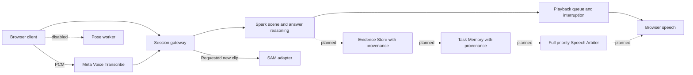

Glint helps people keep their hands on a task while asking for guidance about what is in front of them.

# Glint

**Meta Global AI Developer Hackathon 2026** · Solo: Parvathi Nalla
**Track:** Indie Developer
**Theme:** Build for Your World
Built during the hackathon, Oct 27–Nov 4, 2026. Repository created Oct 29, inside the event window; available commit history starts Oct 28. Asset provenance still requires review.

## Demo

[](https://youtu.be/LNRBw1rmBLQ)

[**▶ Watch the Glint demo on YouTube**](https://youtu.be/LNRBw1rmBLQ)

[Download the MP4](docs/media/Glint-Demo.mp4)

## Problem

Cooking, assembly and crafts occupy your hands. Asking for help should not require repeatedly typing or describing the scene. Camera evidence is incomplete, however. Seeing a bowl tilt does not prove what was in it.

## What it does

- Ask a question by voice or text, with selected recent camera frames as context.
- Hear a short answer and interrupt or end the session using visible controls.
- Request a new object-movement clip when account access and object analysis are enabled.
- Keep user-reported task progress separate from proof of completion in the existing checkpoint workflow.

**Submission profile:** Meta Model API + browser speech. Partner-hosted generative inference and external TTS are not used by this profile, by choice. Local Silero VAD detects speech boundaries; pose inference is disabled. The normal development profile still contains experimental speech providers and image previews. Use the explicit commands below for the submission.

Full provenance memory is the core design, not a claim of complete shipped implementation. [Approved design](docs/GLINT_DESIGN_DOCUMENT.md) defines the five categories: observed, user-reported, inferred, source-derived and model-general. [Scope audit](docs/SUBMISSION_AUDIT.md) records the gaps.

## Meta models and runtime evidence

LIVE in the audit means an implemented API path plus tests, not a verified account receipt. Keep a row in the final submission only after it appears in the recorded demo and its receipt is filled in [LIVE_VERIFICATION](docs/LIVE_VERIFICATION.md).

| Model ID | Job | Code | Endpoint |
| --- | --- | --- | --- |
| `muse-voice-transcribe-1.0` | Realtime speech transcription, with WAV recovery | [ASR adapter](backend/asr-provider.ts), [recovery adapter](backend/agent-provider.ts) | `wss://api.meta.ai/v1/asr/realtime`; `https://api.meta.ai/v1/asr/transcribe` |
| `sam-3.1` | Optional requested clip segmentation and camera-relative movement | [SAM adapter](backend/sam-provider.ts) | `https://api.meta.ai/v1/responses` |

**Conversation:** Glint sends your question, selected camera frames, and conversation context to the Meta Model API. The model connected through your account uses that information to respond to what you are asking about.

**Optional tools:** SAM supports short object-motion clips, while Muse Image supports requested image edits. These tools have implemented adapters and automated test coverage; that does not establish their accuracy in real-world use. They are separate from the main camera-and-voice conversation flow.

## Architecture

Solid arrows show current submission paths. Dashed components are approved design targets, not completed runtime stores or services.



The gateway relays transcription calls; the diagram's PCM edge is a logical data flow, not a direct browser key-bearing connection to Meta. SQLite stores opted-in task progress only. Sessions, conversation and active work are held in memory. Camera frames are selected on requests. Background camera checks are optional and off by default.

## Code layout

- `frontend/`: React/Vite client.
- `backend/`: Node server and Meta Model API adapters.
- `shared/`: types and contracts used by both.
- `tests/`: unit/integration and Playwright suites.

## Run locally

Requires Node 24 LTS, npm and network access for dependencies/model assets. No Docker, GPU, Redis or cloud account is needed to open the labelled fixture replay. Live inference requires a Meta key entered through the app. Clean macOS/Linux installation remains [NEEDS EVIDENCE: run these commands on a clean machine and retain the output; start the check in under ten minutes].

macOS/Linux:

```bash
git clone https://github.com/parvathinalla/Glint.git
cd Glint
npm ci
npm run dev:submission
```

Windows PowerShell:

```powershell
git clone https://github.com/parvathinalla/Glint.git
cd Glint
npm ci
npm run dev:submission
```

Open [the local app](http://127.0.0.1:3100). The labelled submission banner identifies browser speech and pose-off mode. Choose **Open fixture replay · no key, no AI inference** for the existing organizer example. It is not a live model demonstration. The main camera-and-voice flow needs a connected key. See the [60-second walkthrough](docs/JUDGE_PATH_AND_FIXES.md).

Server secrets, if used for experiments, belong in ignored environment files. No server-side Meta key is needed for the main submission. Browser voice availability and quality depend on the device. Build and serve the same profile with `npm run build:submission` and `npm run start:submission`; production requires an HTTPS application origin.

## Salt example: required behavior, not a verified demo result

1. Observed: the small bowl moved over the pot and tilted.
2. Not observed: the contents of the bowl entering the pot.
3. Inferred: an ingredient may have been added; salt is not confirmed.
4. User-reported or source-derived information must remain attributed separately.
5. Reply: “I saw the bowl tilt, but couldn't see its contents. I can't confirm the salt. Taste before adding more, if appropriate.”

[NEEDS EVIDENCE: record this exact uncertainty behavior in one live run. If it fails, show the failure and remove factual ingredient-memory claims.]

## Verification

**Verified test total:** 355 unit/integration tests passed (`npm test`)

```bash
npm test
```

Entrant supplied the final unit summary on Nov 3: 355 passed. The initial browser run reported 73 passed and 2 failed. After the documented repairs, the full browser rerun passed; see the separate browser receipt in [TEST_EVIDENCE](docs/TEST_EVIDENCE.md). The original failed run remains in the receipt. Record the final commit SHA and require CI on that revision. Browser tests are a separate suite: `npx playwright install chromium`, then `npm run test:e2e`. Never add spec-file counts to passed-test totals. Tests use fixtures and synthetic media; they do not establish live accuracy. Additional checks: `npm run lint` and `npm run build:submission`.

[](https://github.com/parvathinalla/Glint/actions/workflows/production-check.yml)

The badge reports committed main, not an unpushed working tree. Local checks passed during this audit; the final commit must pass CI again.

## Known limitations

- The full provenance Evidence Store, cross-clip object registry and priority Speech Arbiter are design targets. Current checkpoint steps distinguish pending from user-reported; this is narrower than the design.
- The camera does not establish unseen actions, ingredient contents, safe doneness or other safety-critical conditions.
- Background speech can interrupt. There is no speaker-identity guarantee.
- Most inference shares a bounded session lane. The design's fully independent vision/voice scheduling is incomplete.
- SAM analyzes a new short MP4 clip; it does not recover past actions or compensate for camera motion. Account entitlement and browser format support must be checked.
- Submission mode does not automatically upload a WAV recording if live transcription fails. It shows a retry/text-input notice. The regular experimental profile retains recording recovery.
- Sessions are private device sessions, not managed accounts. Restart loses active state and requires reconnecting the key. The session allowance is 3000 provider dispatches; it is not a monetary cost governor.
- Performance targets in the design are targets, not achieved measurements. A laptop tunnel is temporary hosting.

## Roadmap — not shipped

We will implement the full provenance schema, conflicting-claim history and evidence-linked task memory. We will qualify independent voice/vision scheduling, calibrated temporal understanding, a complete priority speech arbiter and budget-aware admission. Managed auth, PostgreSQL, durable jobs and cross-clip identity tracking will require separate implementation and validation. Optional design models such as Muse Wonder will remain off until justified by measurements.

## License and documentation

Project code: [MIT](LICENSE). Third-party model assets and media retain their own notices; the MIT license does not relicense them. [NEEDS EVIDENCE: rights and event-window provenance for the supplied avatar video. Confirm its source and permission in under ten minutes.]

[Read the docs in order](docs/README.md). Previous README material was moved intact to [build-log.md](docs/build-log.md), including its historical claims and conflicts.

### More Glint videos

Additional Glint recordings will be added here.

<!-- Add each uploaded clip below using this format:
- [Short descriptive video title](docs/media/your-video.mp4)
YouTube links can be used instead of repository files.
-->
