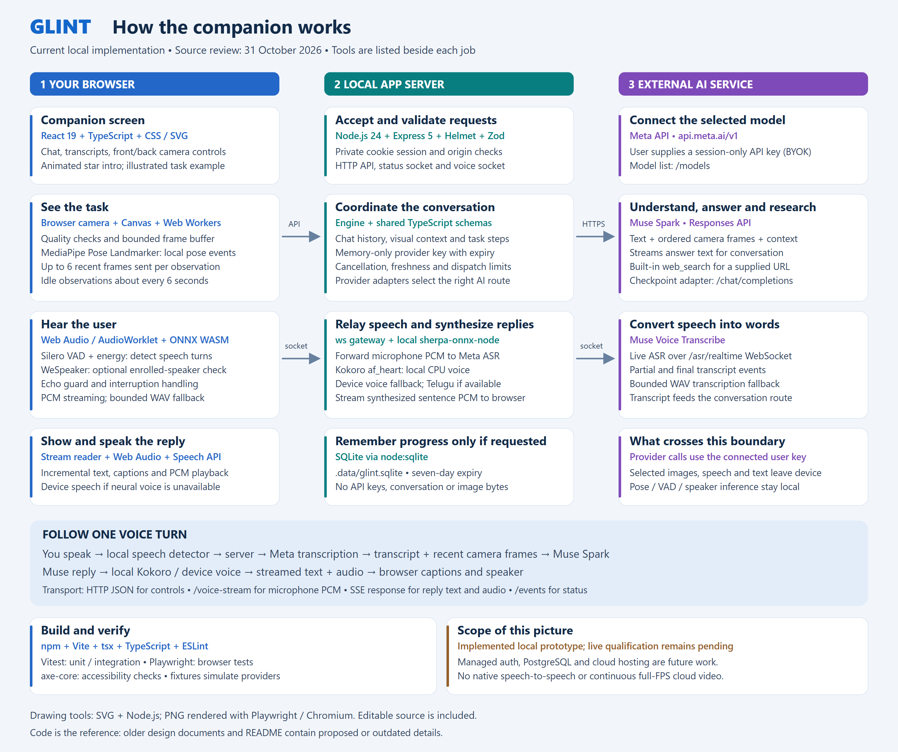

# Glint: current implementation and tools

Source review: 31 October 2026. This documents the local implementation, rather than the proposed cloud system in older architecture plans.

[Editable SVG](assets/glint-current-architecture.svg). Regenerate both images with `node scripts/draw-architecture.mjs`. Drawing uses SVG and Node.js; Playwright/Chromium renders the PNG.

## Which tool does which task?

| Task | Implemented tool | Main source |
| --- | --- | --- |
| Companion UI and intro | React 19, TypeScript, CSS, original SVG, browser animation frames; Lucide icons | `src/App.tsx`, `src/CompanionHome.tsx`, `src/Opening.tsx`, `src/OpeningCharacter.tsx` |
| Camera preview and recent visual evidence | getUserMedia, Canvas JPEG encoding, bounded ring buffer, quality Web Worker | `src/camera.ts`, `src/quality.worker.ts`, `shared/buffer.ts` |
| Local person / hand-rise events | MediaPipe Pose Landmarker in a Web Worker | `src/visual-awareness.ts`, `public/vision-observer.js`, `shared/visual-events.ts` |
| Speech capture and turn detection | Web Audio, AudioWorklet, Silero VAD using ONNX Runtime Web/WASM, energy detection | `src/microphone.ts`, `src/ml-vad.ts`, `public/voice-capture.js`, `shared/voice-turn.ts` |
| Optional speaker check | WeSpeaker ResNet34-LM, ONNX Runtime Web/WASM, locally enrolled voiceprint | `src/speaker-id.ts` |
| Streaming speech recognition | Browser WebSocket to local server; server `ws` adapter to Meta Muse Voice Transcribe `/asr/realtime` | `src/voice-stream.ts`, `server/asr-provider.ts`, `server/app.ts` |
| Utterance fallback recognition | Bounded WAV upload to Meta `/asr/transcribe` | `server/agent-provider.ts` |
| Conversation and camera understanding | Muse Spark through Meta `/responses`; text deltas streamed when applicable | `server/agent-provider.ts`, `server/engine.ts` |
| Optional manual-link research | Meta Responses built-in `web_search`, with returned citations | `server/agent-provider.ts` |
| Illustrated checkpoint coaching | Task prerequisites and validated decisions; Meta `/chat/completions`; explicit no-key demo replay | `shared/model.ts`, `server/provider.ts`, `server/engine.ts` |
| Local generated speech | Kokoro af_heart through `sherpa-onnx-node` on CPU; device speech fallback for Telugu | `server/tts-kokoro.ts`, `server/tts-stream.ts` |
| Reply playback and interruption | Web Audio PCM playback, device `speechSynthesis` fallback, echo/barge guards | `src/voice-player.ts`, `src/speech-queue.ts`, `src/echo.ts`, `src/barge-guard.ts` |
| HTTP and session boundary | Node 24, Express 5, Helmet, Zod, private cookies, origin/CSRF checks | `server/index.ts`, `server/app.ts` |
| Coordination and cancellation | In-memory session engine, request IDs, epochs, freshness checks, bounded dispatch | `server/engine.ts`, `shared/agent.ts` |
| Optional saved task progress | Node built-in SQLite, seven-day expiry | `server/store.ts` |
| Build and development | npm, Vite, tsx, TypeScript, ESLint | `package.json`, `vite.config.ts`, `tsconfig.json`, `eslint.config.js` |
| Automated verification | Vitest, Playwright/Chromium, axe-core accessibility, synthetic media/provider fixtures | `tests/`, `vitest.config.ts`, `playwright.config.ts` |
| Local model preparation | Pinned model/runtime preparation scripts; downloaded local model assets | `scripts/prepare-*.mjs`, `public/vision/`, `public/vad/`, `public/speaker/` |

## Read the flow

1. The user opens the camera/microphone and connects a Meta API key. The server lists supported models. Listing alone does not prove every model capability works.
2. Local browser processing detects speech, checks optional speaker enrollment and samples camera evidence. Recent camera requests contain up to six ordered frames from eight seconds. The underlying ring is bounded to twelve seconds, 32 frames and 4 MiB.
3. Microphone PCM travels through `/voice-stream` to Meta ASR. A bounded WAV path is available as a fallback. Final speech text feeds the conversation path.
4. The engine assembles conversation and recent visual context, validates the request, and calls Muse Spark. Optional URL research uses provider web search. Idle camera observations target six-second intervals and yield to active voice work.
5. `/api/agent/stream` returns an SSE-formatted HTTP response with text deltas and, when available, local synthesized audio events. Kokoro generates local speech; browser speech is the output fallback. Telugu requests a compatible device voice when available. Text remains usable independently. Canceled queued synthesis is skipped and long replies can emit phrases before final punctuation.
6. The browser displays text/captions, plays audio and handles interruption. Fullscreen camera includes live/final transcript text and a front/back camera switch. `/events` is a separate status WebSocket. Stop/new-task/disconnect invalidate relevant pending work. Voice reconnects on the next turn after a browser-socket disconnect; lost audio selects complete-recording fallback.

## Storage and current limits

Raw provider keys live in server memory only, with fifteen-minute idle and two-hour absolute expiry. Optional SQLite persistence includes reviewed task/source/progress data, not keys, chat or images. Browser localStorage does contain UI preferences and an enrolled speaker voiceprint when the user enrolls; this is separate from provider-key handling.

The current engine constant is **100 provider dispatches per session**, not the older README's 40. This is an application allowance, not a monetary spending cap. Sessions are local cookie sessions, not managed account authentication. The server binds to loopback; public deployment remains gated.

Managed auth, PostgreSQL, object storage, SAM tracking, LiveKit, Docling, Rive and GPU hosting appear as proposals or candidates in plans; they are not active integrations in this implementation. `three` appears in package dependencies, but no source import was found, so it is not shown as the active rendering engine.

This review and diagram do not establish live provider accuracy, latency or production readiness. No credentials or paid provider calls were used, and application tests were not rerun for this documentation-only change. The generated PNG was rendered and visually inspected.
