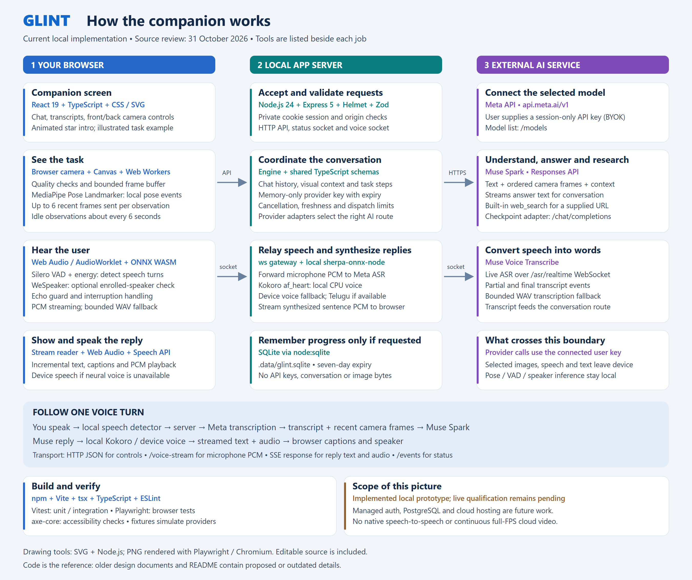

# Glint: current implementation and tools

Source review: 3 November 2026. Historical diagrams may show earlier voice backends; the table and flow below describe current code. This documents the local implementation, rather than the proposed cloud system in older architecture plans.

[Editable SVG](assets/glint-current-architecture.svg). Regenerate both images with `node scripts/draw-architecture.mjs`. Drawing uses SVG and Node.js; Playwright/Chromium renders the PNG.

## Which tool does which task?

| Task | Implemented tool | Main source |
| --- | --- | --- |
| Companion UI | React 19, TypeScript, CSS, video/canvas star avatar with jelly-image fallback; Lucide icons | `frontend/App.tsx`, `frontend/CompanionHome.tsx`, `frontend/SilverStar.tsx` |
| Camera preview and recent visual evidence | getUserMedia, Canvas JPEG encoding, bounded ring buffer, quality Web Worker | `frontend/camera.ts`, `frontend/quality.worker.ts`, `shared/buffer.ts` |
| Local person / hand-rise events | MediaPipe Pose Landmarker in a Web Worker | `frontend/visual-awareness.ts`, `public/vision-observer.js`, `shared/visual-events.ts` |
| Optional recorded object movement | SAM 3.1, official Meta SAM parser, normalized per-frame box centers; experimental two-second clips | `backend/sam-provider.ts`, `shared/object-motion.ts`, `docs/OBJECT_TRACKING.md` |
| Speech capture and turn detection | Web Audio, AudioWorklet, Silero VAD using ONNX Runtime Web/WASM, energy detection | `frontend/microphone.ts`, `frontend/ml-vad.ts`, `public/voice-capture.js`, `shared/voice-turn.ts` |
| Streaming speech recognition | Browser WebSocket to local server; server `ws` adapter to Meta Muse Voice Transcribe `/asr/realtime` | `frontend/voice-stream.ts`, `backend/asr-provider.ts`, `backend/app.ts` |
| Utterance fallback recognition | Bounded WAV upload to Meta `/asr/transcribe` | `backend/agent-provider.ts` |
| Conversation and camera understanding | Muse Spark through Meta `/responses`; text deltas streamed when applicable | `backend/agent-provider.ts`, `backend/engine.ts` |
| Optional manual-link research | Meta Responses built-in `web_search`, with returned citations | `backend/agent-provider.ts` |
| Illustrated checkpoint coaching | Task prerequisites and validated decisions; Meta `/chat/completions`; explicit no-key demo replay | `shared/model.ts`, `backend/provider.ts`, `backend/engine.ts` |
| Generated speech | LiveKit Inference streaming PCM; optional local Kokoro backend | `backend/tts-livekit.ts`, `backend/tts-kokoro.ts`, `backend/tts-stream.ts` |
| Reply playback and interruption | Web Audio PCM playback, explicit device `speechSynthesis` option, echo/barge guards | `frontend/voice-player.ts`, `frontend/speech-queue.ts`, `frontend/echo.ts`, `frontend/barge-guard.ts` |
| HTTP and session boundary | Node 24, Express 5, Helmet, Zod, private cookies, origin/CSRF checks | `backend/index.ts`, `backend/app.ts` |
| Coordination and cancellation | In-memory session engine, request IDs, epochs, freshness checks, bounded dispatch | `backend/engine.ts`, `shared/agent.ts` |
| Optional saved task progress | Node built-in SQLite, seven-day expiry | `backend/store.ts` |
| Build and development | npm, Vite, tsx, TypeScript, ESLint | `package.json`, `vite.config.ts`, `tsconfig.json`, `eslint.config.js` |
| Automated verification | Vitest, Playwright/Chromium, axe-core accessibility, synthetic media/provider fixtures | `tests/`, `vitest.config.ts`, `playwright.config.ts` |
| Local model preparation | Pinned model/runtime preparation scripts; downloaded local model assets | `scripts/prepare-*.mjs`, `public/vision/`, `public/vad/` |

## Read the flow

1. The user opens the camera/microphone and connects a Meta API key. The server lists supported models. Listing alone does not prove every model capability works.
2. Local browser processing detects speech and samples camera evidence. Recent camera requests contain up to six ordered frames from eight seconds. The underlying ring is bounded to twelve seconds, 32 frames and 4 MiB.
3. Microphone PCM travels through `/voice-stream` to Meta ASR. A bounded WAV path is available as a fallback. Final speech text feeds the conversation path.
4. The engine assembles conversation and recent visual context, validates the request, and calls Muse Spark. Optional URL research uses provider web search. Opt-in idle camera checks run at most every 30 seconds, up to 20 checks per page, and yield to voice work.
5. `/api/agent/stream` returns an SSE-formatted HTTP response with text deltas and, when available, synthesized audio events. LiveKit Inference supplies incremental PCM when cloud voice is configured. Cloud failures do not silently switch to device speech; device voice is an explicit setting. Text remains usable independently. Canceled queued synthesis is skipped and long replies can emit phrases before final punctuation.
6. The browser displays text/captions, plays audio and handles interruption. Fullscreen camera includes live/final transcript text and a front/back camera switch. `/events` is a separate status WebSocket. Stop/new-task/disconnect invalidate relevant pending work. Voice reconnects on the next turn after a browser-socket disconnect; lost audio selects complete-recording fallback.

## Storage and current limits

Raw provider keys live in server memory only, with fifteen-minute idle and two-hour absolute expiry. Optional SQLite persistence includes reviewed task/source/progress data, not keys, chat or images. Browser localStorage does contain UI preferences (legacy saved voiceprints are ignored); this is separate from provider-key handling.

The current engine constant is **100 provider dispatches per session**, superseding the historical 40-call allowance. This is an application allowance, not a monetary spending cap. Sessions are local cookie sessions, not managed account authentication. Development binds to loopback; production binds to 0.0.0.0 by default and requires an HTTPS origin. See PRODUCTION_RENDER.md for deployment requirements.

Managed auth, PostgreSQL, object storage, continuous tracking, Docling, Rive and GPU hosting remain proposals or candidates. LiveKit Inference TTS is implemented in the main app; the optional `/livekit` room agent remains a separate comparison flow. An experimental user-triggered SAM recorded-clip path is implemented; it is not a persistent cross-clip tracker. The unused `three` dependency was removed. Earlier architecture illustrations predate some of these changes; see `OBJECT_TRACKING.md` for tracking boundaries.

This review and historical diagram do not establish live provider accuracy, latency or production readiness. Automated verification uses fixtures and synthetic media; real-device behavior requires live testing.
