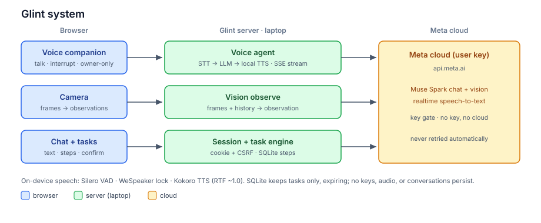

# Glint — Design Doc

## 1. Executive summary

Imagine a friend sitting next to you who can see what you see, hear
what you say, and talk you through whatever you're doing — braiding
your hair, picking glasses, following a recipe. That friend is Glint.

Glint is an AI companion that runs on your own laptop. It watches
through your camera, listens through your microphone, speaks back in
one warm consistent voice, and keeps track of multi-step tasks so you
never lose your place. It answers only to you — background chatter and
other people can't hijack it — and you can interrupt it mid-sentence,
just like a real conversation.

Under the hood, everything personal stays home: the ears, the eyes'
first pass, the voice, and your data all live on your machine. The only
thing Glint borrows from the cloud is raw brainpower — language and
vision understanding from Meta's API, using your own key.

## 2. Problem statement

Talk to any voice assistant today and you'll hit the same walls:

- They can't see you. A chatbot can describe how to braid
  hair, but it can't watch your hands and tell you what to fix.
- Every device mangles speech differently. Your reply sounds like a
  robot on one phone, a different robot on another — never like one
  friend with one voice.
- Noise breaks them. A fan, a kitchen, a street — the assistant either
  goes deaf or answers the TV.
- You can't interrupt. Try cutting in mid-reply and most systems talk
  over you, freeze, or lose the thread entirely.
- Nobody follows along. Online guides list ten steps and leave you to
  remember which one you're on.

Glint exists to knock down all five: a companion that sees, hears
through noise, speaks in one voice, lets you interrupt, ignores
strangers, and walks each task with you — aiming past ChatGPT Voice
and Gemini Live on every one of these.

## 3. Architecture

Think of Glint as three rooms in a row:

1. **Your browser — the senses.** Three doors in: talking (voice),
   showing (camera), and typing/clicking (chat and tasks). The browser
   also holds two tiny on-device brains: one that knows speech from
   noise, and one that knows your voice from everyone else's.
2. **Your laptop — the host.** A small server greets every request,
   checks your session, and routes it: voice turns go to the voice
   agent, camera frames to vision, instructions to the task engine.
   Your laptop also speaks — it synthesizes Glint's voice itself — and
   keeps your task progress in a small local database.
3. **Meta's cloud — the borrowed brain.** For understanding words and
   pictures, Glint asks Meta's models over your own API key. No key,
   no cloud — Glint simply runs quieter instead of breaking. And it
   never retries a failed paid call on its own, so a hiccup can't
   silently run up your bill.

Nothing you say, show, or do is stored anywhere except your current
task list — and even that expires.

## 4. Technical design

**Voice — a relay race with no dropped baton.** Your words pass through
six runners: the microphone, a noise-proof speech detector (Silero,
backed by an energy ear that learns your room's hum), a bouncer that
checks the voice is yours (WeSpeaker), cloud transcription, the LLM's
answer, and your laptop speaking each sentence the moment it's ready.
If you talk over Glint, it pauses like a polite human; if you actually
start a new thought, it drops the old one cleanly and follows you.
Every slice of audio carries a turn ticket, so a late slice from an
old thought can never blurt out over the new one. Long sentences are
cut at natural clause breaks so speech starts in under a second, and
if any single sentence fails to synthesize, the device voice covers
just that sentence — the reply is never silent.

**Vision — eyes with a short memory.** Every couple of seconds the
camera sends a few snapshots to the server, which shows them to Meta's
vision model along with what you were just talking about. The result —
"she's holding her glasses up to the camera" — becomes part of the
conversation's memory, so Glint's next answer can point at what it
sees. Snapshots evaporate with the session; Glint remembers the
scene, never the pictures.

**Tasks — a guide who holds your place.** Give Glint any instructions
with a few steps, review them, and confirm. From then on it knows the
order, refuses out-of-order check-offs, and if you undo a step, it
neatly unchecks everything after it. A built-in demo task shows off a
branching plan. Only the bare step list is saved, locally, with an
expiry date.

**Sessions and keys — your house, your rules.** There are no accounts:
your browser holds a private session cookie, every request carries a
matching passcode, and reloading starts a fresh era that can't resurrect
an old camera run. Cloud features unlock when you connect your own Meta
key — which, like everything personal, is never written to disk.

## 5. API framework

Every address below lives on your laptop, behind your session. Think
of them as labeled doors — each does exactly one job and answers in
plain JSON, except the two live streams at the bottom.

| Door | Answers in | What it does |
|---|---|---|
| `GET /api/session` | JSON | start or resume your private session |
| `POST /api/voice` | JSON | one spoken turn: hear it, think, answer |
| `POST /api/agent/stream` | live stream | the conversation as it happens, words + voice |
| `POST /api/agent` | JSON | same answer, delivered whole |
| `POST /api/chat` | JSON | one typed message, answered |
| `POST /api/new` | JSON | wipe the conversation, start fresh |
| `POST /api/observe` | JSON | "here's what the camera sees" → what it means |
| `POST /api/check` | JSON | judge a single captured frame, live |
| `POST /api/vision/stop` | JSON | close Glint's eyes, forget the scene |
| `POST /api/task` | JSON | hand over instructions + steps |
| `POST /api/demo` | JSON | load the sample branching task |
| `POST /api/confirm` | JSON | "yes, these are the steps" (by revision) |
| `POST /api/step` | JSON | check off (or undo) a step |
| `POST /api/phase` | JSON | ready, active, or paused |
| `POST /api/key` | JSON | connect your Meta key |
| `DELETE /api/key` | JSON | disconnect it |
| `DELETE /api/session` | JSON | forget everything: session + task |
| `WS /voice-stream` | live audio | microphone streaming in, binary |
| `WS /events` | live JSON | server taps you on the shoulder |

The live conversation stream speaks five words: `delta` (here's more
text), `voice` (neural voice on or off), `audio` (here's the next
spoken slice), `audio-error` (that slice failed — cover it), and
`voice-done` (the reply finished speaking). Mistakes come back as
typed errors — a number, a code, and a human sentence — never a crash.

## 6. Performance metrics

Measured on an ordinary laptop CPU (phone verification still in
progress — those cells get filled by a human run):

| What we timed | Glint |
|---|---|
| Speaking speed | about realtime (RTF ~1.0 on a healthy laptop) |
| First sound | ~2–4 s after the first sentence + thinking time |
| Hearing you | 0.6–2 s to transcribe a turn |
| Thinking | 1.6–5 s for a full answer |
| Seeing | 1–4.5 s per batch of frames |
| Noise test | hears you with the neural ear on, silence with it off |
| Stranger test | owner scores ≥ 0.67, strangers ≤ 0.25 |
| Unit/integration | 236 passing; 9 HTTP checks pass port-allowed |
| Browser e2e | 36/36, real Chrome, isolated port |
| Real-model tests | speech, speaker, and Kokoro voice, committed |

One honest caveat, because a master explainer never hides the catch:
Glint thinks in a relay — hear, then think, then speak — so its first
word lands about a second after it starts thinking, not in the ~300 ms
of systems that speak straight from sound. In exchange you get things
those systems don't have at all: one voice on every device, speech
that needs no internet and costs nothing per word, interruptions it
can prove it handles, a camera-aware memory, step tracking that holds
your place, and a room where only your voice counts.
