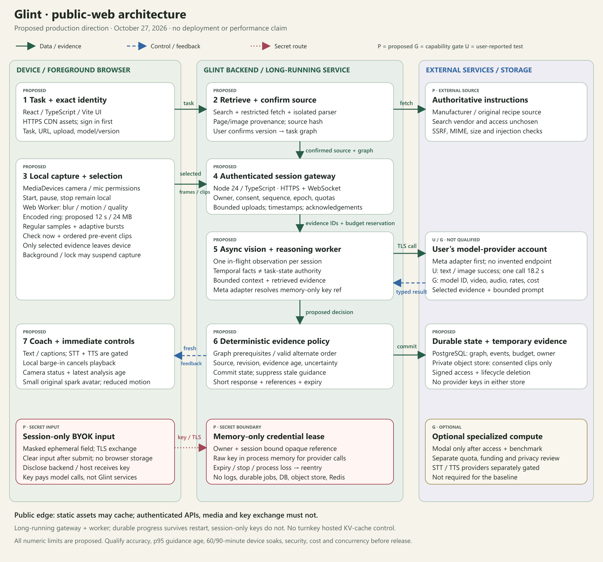
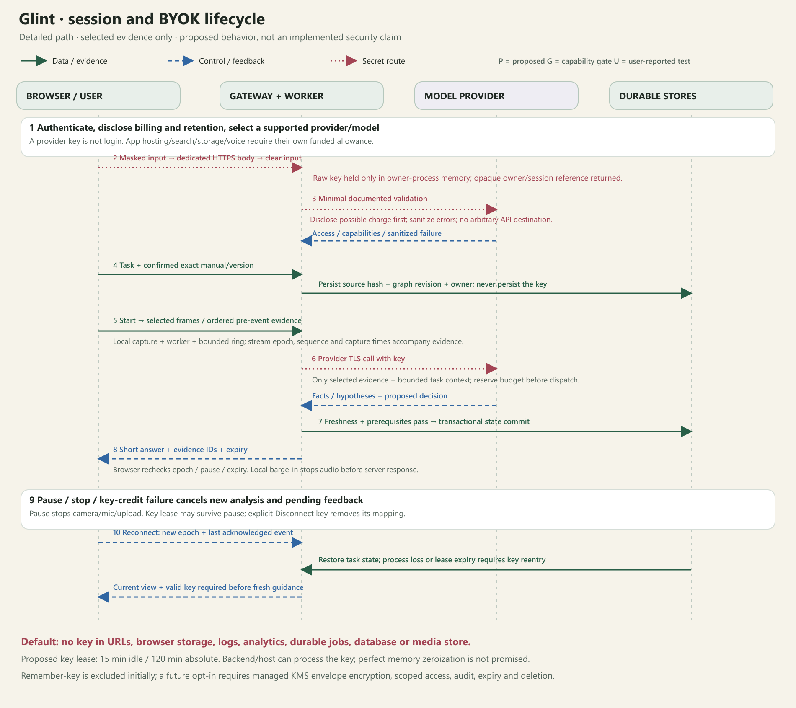

# Glint public-web architecture

October 27, 2026 · Proposed production architecture. See [IMPLEMENTATION.md](IMPLEMENTATION.md) for the local checkpoint implementation and remaining gaps.

Glint is a public website for foreground-active camera coaching. A signed-in user supplies their own supported model-provider key, confirms the exact task instructions, then starts a camera session. Glint combines selected visual evidence with a confirmed task graph to answer questions and offer respectful corrections. The browser owns capture and immediate controls; the backend owns authorization, bounded inference, evidence checks, and durable progress.

## Architecture images

[Open the scalable architecture SVG](assets/glint-architecture.svg). The companion image expands key handling, observation, interruption, and recovery:

[Open the scalable session SVG](assets/glint-session-byok.svg). Images are deterministic technical drawings, not generated illustrations. Labels describe proposed responsibilities; no provider logo or arrow implies a deployed integration. The SVG assets preserve editable diagram source.

## 1. Smallest proposed stack and why

These are concrete technology choices for a first implementation, not confirmed vendor integrations. Hosting, managed identity/database/storage, and search vendors remain procurement decisions. Choose one vendor per responsibility after verifying limits and terms; do not add overlapping platforms.

| Problem | Component and proposed technology | Why it belongs here |
|---|---|---|
| Public access and responsive interface | TypeScript + React, built as static assets with Vite; HTTPS CDN/edge | One phone/desktop UI; assets cache globally while private APIs and media remain non-cacheable. A separate app server-rendering framework is unnecessary for this interaction |
| Capture without freezing controls | `MediaDevices.getUserMedia`, browser encoders where supported, dedicated Web Worker for downscaled quality/motion checks | Keeps local pause, stop, captions, and interruption responsive; browser support and transfer/encoding paths need real-device tests |
| Missing small or fast actions | Byte-capped encoded ring buffer; regular samples plus adaptive bursts and Check now | Scene change alone is inadequate. Retain ordered pre-event/action/post-event evidence rather than sending an uninterrupted raw stream |
| User isolation and real-time coordination | Node 24 LTS + TypeScript, small HTTP server and WebSocket gateway on a long-running container/service | Authenticates every session, applies backpressure and budget policy, and acknowledges durable events. WebSockets carry control/results; bounded HTTPS media uploads avoid control messages waiting behind large clips |
| Slow analysis without blocking the gateway | Async session worker in the same long-running deployment initially; isolated parser worker for untrusted documents | Scheduling and provider waits cannot become a long-lived serverless request. Keep one in-flight vision job per session and isolate parser CPU/memory/time limits |
| Provider differences | One Meta adapter first, runtime-validated request/decision schemas | The user reports text/image tests. Exact model ID, video, ordered multi-image input, streaming, audio, rates, and cancellation remain gates; no invented endpoints |
| Progress and reconnects | Managed PostgreSQL + managed authentication | Transactional graph revisions, event IDs, source hashes, evidence metadata, lease fencing, and budget ledger. Use ordinary indexed/JSON/full-text queries before adding vector infrastructure |
| Short-lived visual evidence | Private object storage, ideally with the database vendor | Keeps bounded consented clips separate from durable task records. Signed short-lived reads, per-user paths, lifecycle deletion, and no key storage |
| Wrong instructions | One search API + restricted HTTP fetch + isolated PDF/HTML extraction | Search finds candidate manufacturer/original recipe sources; extraction keeps source pages, images, quantities, and provenance. Exact identity/version confirmation gates coaching |
| Voice without stale monologues | Separate STT and TTS adapters, browser audio playback and local interruption detection | Provider voice support is not assumed. Keep text usable and test echo cancellation, captions, and barge-in before enabling full voice |
| Optional specialized temporal compute | Modal worker only if access is approved and benchmarked | Add only if the initial adapter cannot pass temporal gates and a measured worker improves them at acceptable cost. GPU tracking is not a baseline requirement |

No Redis, broker, vector database, multiagent framework, or GPU service is needed in the baseline. Workers and gateway can share a process while measured resource isolation permits; heavy parsing uses a bounded child process. Before multiple replicas, use sticky session routing and PostgreSQL leases/fencing. If a job moves to another process, its session-only raw key is unavailable: require reentry or an explicitly designed secure secret handoff. Do not put keys into durable job payloads to make retries easier.

## 2. Public deployment boundary

Use an HTTPS public origin with CDN-hosted static assets and authenticated `/api` and WebSocket routes forwarded to the long-running gateway. Disable caching and body capture for private routes, including the key submission route. Verify the actual proxy idle/connection limits and reconnect behavior. Do not place a supposedly persistent coaching loop inside a short-lived request handler. Rolling deployments drain sessions, record a gap, and may require key reentry; availability does not justify persisting raw keys.

Managed auth provides identity; application authorization still checks ownership for every task, source upload, session, signed media read, and mutation. Use secure HTTP-only cookies where appropriate, origin/CSRF checks, short-lived transport authorization, per-user quotas, request byte limits, and fair admission control. Apply a restrictive CSP, pin dependencies, avoid third-party analytics on key/camera views, and keep application service credentials only in the server's managed secret configuration. A provider key is not user authentication.

The supported initial mode is a visible, foreground-active browser session. Browser/OS background tabs, lock screens, memory pressure, and thermal policies can suspend capture. Detect visibility, media-track, and connection changes; pause uploads and mark missing evidence. A wake-lock feature, if supported and tested, is an optional convenience, not a background-camera guarantee. Native mobile remains a separate future investment for sustained capture and device control, still subject to OS constraints.

## 3. Session-only BYOK

### User-facing contract

Before key submission, explain: “Your key is sent securely to Glint's backend so it can call the selected provider for this session. The backend and its hosting infrastructure process it. Model usage is billed to your provider account. Glint does not save the key by default. You may need to enter it again after a restart or session expiry.” Never promise zero operator access or restrictions the provider cannot enforce.

Display provider, exact supported model, validation action, billing implications, retention terms, and estimated session spend. Use a dedicated key/project with least privilege and provider-side limits when the provider supports them; do not claim such controls universally exist. Do not accept an arbitrary user-entered API base URL in the first release. An allowlisted adapter prevents credential forwarding to attacker-selected endpoints.

### Secret path

1. The authenticated user pastes a key into a masked field after seeing the disclosure. Never put it in a URL, localStorage, sessionStorage, IndexedDB, cookies, analytics, error reporting, or general application state snapshots. Keep the field value ephemeral and clear it after exchange. Browser extensions and compromised client/server code remain risks; backend proxying does not eliminate them.
2. Send it once in the body of a dedicated TLS-protected HTTPS request with no-store handling. Proxies, edge services, tracing, and crash tools must have body/header capture disabled on this path. A session ID or opaque reference is the only credential handle used in ordinary control messages.
3. Backend memory holds `{owner, session, provider, key, expiresAt}`. The raw key exists in server process memory when the adapter calls the provider over TLS. Bind the reference to the authenticated owner and session; a leaked reference alone must not authorize calls. Do not persist the key/reference mapping in PostgreSQL, object storage, job payloads, or Redis as a pretend vault.
4. Validate with the minimum supported documented operation: a model/capability listing if available, otherwise a clearly disclosed minimal billable request after user consent. Key format checks alone do not establish access. Return sanitized capability/error codes, never provider errors that could echo secrets. Provider identity, endpoint, and validation behavior must be verified before implementing this path.
5. Use a short configurable key lease, initially proposed as 15 minutes idle / 120 minutes absolute, independent of the longer task-state retention period. Show expiry and renewal/reentry clearly. On explicit disconnect-key, end-session, expiry, or process death, discard the mapping and cancel pending dispatch. Pause stops capture and analysis; the UI must disclose whether its still-valid session key remains in memory, and offer Disconnect key.

An ordinary transport reconnect can reuse the live key reference only if the original owner process and lease survive. A process restart, failover, or expired lease requires reentry by default. Restore durable progress without pretending to restore the key. A new stream epoch and a current view are required before guidance resumes. JavaScript runtime memory cannot guarantee cryptographic zeroization of every copy; minimize copies, lifetime, heap dumps, and exposure rather than claiming perfect erasure.

### Optional remembered key: excluded from the first release

Only add an opt-in remembered-key feature with managed KMS envelope encryption, authenticated per-user authorization, separate ciphertext storage, minimal decrypt permissions, key rotation, access audits containing metadata only, explicit expiry, and tested deletion including documented backup behavior. The application must decrypt transiently to call the provider. Do not label database encryption-at-rest alone as an implemented secret vault. Do not build this feature merely to hide process-restart reentry.

## 4. Coaching process and evidence flow

1. **Find:** task text/voice, URL/manual, or label image enters the source workflow. Search authoritative publishers, fetch through SSRF controls, extract text and original diagrams, and build source/parts/step/dependency records with page references and hashes. Limit bytes, pages, MIME types, redirects, DNS resolution, parser time, and memory. Treat retrieved material as data, never tool instructions.
2. **Confirm:** resolve exact model/version/region or recipe and show the approved source. Missing or conflicting instructions block affected guidance. Task graph alternatives must be supported, not invented by a model.
3. **Capture:** after user start, acquire camera/mic separately. Proposed local baseline: 720p/15fps capture, 12-second/24MB encoded ring, downscaled quality checks around 5fps. Actual feasibility depends on device codecs and browser APIs.
4. **Select:** regular ~1fps observations plus activity bursts and user checks. Retain ~4 seconds pre-event and ordered 3–6-second action clips or supported frame sequences. Inference rate is separately bounded; it is not the capture fps. Never silently drop a significant event; record a gap and ask for a new view on overflow.
5. **Schedule:** gateway checks owner, consent, key availability, task/stream version, quality, queue/age limits, and reserved spend. Initial per-session limit: one in-flight vision request, one replaceable routine sample, three event clips / 32MB total pending. HTTPS uploads produce evidence IDs; WebSocket messages refer to them. An incomplete/expired upload cannot trigger a verified action.
6. **Interpret:** worker sends only selected evidence, relevant approved instructions, and bounded retrieved memory to the adapter. Temporal perception emits observed facts and hypotheses; task reasoning proposes structured decisions. Native video and ordered-image support must be verified. If unsupported or too slow, offer labeled checkpoint assistance.
7. **Gate:** deterministic policy checks source/graph revision, prerequisites, evidence availability, contradictions, calibrated confidence, and latest relevant capture age. A valid alternate order is allowed; an occluded prerequisite remains unknown. State transitions commit transactionally before acknowledgements.
8. **Respond:** return short text/captions and optional speech with evidence references and expiry. Browser rechecks stream epoch, pause/interrupt state, and expiry before presenting it. Local barge-in stops playback without waiting for inference. Stale responses can contribute historical evidence where appropriate but cannot become current spoken corrections.

Keep task history and searchable evidence metadata durable, with bounded context windows and summaries that retain evidence pointers. Keep raw ring video local; upload only selected evidence under consent. Proposed temporary upload retention is at most 15 minutes, with progress retained seven days only when the user opts into resume. Do not confuse deletion from Glint with a provider's independently governed retention. No secrets go into media or source stores.

## 5. Who pays, and how usage stops

BYOK funds only calls accepted and billed by that key's provider. It does not pay Glint's hosting, search API, PostgreSQL/auth, object storage/egress, separate STT/TTS, or optional Modal compute. The application needs an operator-funded allowance, subscription, or explicit app credit budget for those resources before public release. Additional provider keys should only be introduced if a chosen service needs them and the UX explains their separate billing.

Show two estimates: **your model-provider usage** and **Glint service allowance**. Reserve conservative per-call usage, reconcile actual billed units when available, and bound retries, output tokens, observations, session duration, and escalation. A local cutoff blocks new dispatch; it cannot guarantee an account-wide provider hard cap, reverse in-flight charges, or account for use elsewhere. Provider-side budgets, where supported, complement the app limit.

On invalid/revoked key, exhausted credit, 429, timeout, or unknown billing, stop new paid work and show a clear degraded state. Retain approved static instructions, offer key replacement, and prevent retry storms. Queued evidence expires; restoring credit cannot replay stale advice. The known access evidence remains user-reported Meta text/image success and one 18.2-second image description, without an independent accuracy check. Baseten/Modal/Fireworks applications remain pending. BYOK does not expose model KV-cache controls or turn research methods into hosted API features.

## 6. Implementation order and public-release gates

Build in the order in [GLINT_PLAN.md](GLINT_PLAN.md): capability/latency spike; identity and source graph; public shell with session-only BYOK; checkpoint loop; temporal evidence and recovery; voice; production qualification. Keep public deployment closed to uncontrolled use until authentication, key handling, quotas, and funding are verified. Select the first task and supported phone/browser before broad claims.

All gates are proposed, not achieved:

- **Task accuracy:** independently labeled held-out recordings; report timely missed-error recall, false corrections per attempt and session-hour, abstention/observability, valid alternate orders, wrong-manual blocking, and evidence grounding. Candidate thresholds remain in [GLINT_DESIGN.md](GLINT_DESIGN.md).
- **Fresh guidance:** measure p50/p95 end-to-end capture/action-to-visible guidance and first speech, plus queue age. Proposed simple-check p95 ≤5 seconds; temporal action-onset p95 ≤8 seconds. The 18.2-second call does not pass. Never equate capture fps with reasoning speed.
- **Camera and conversation:** real-device pause/stop halts camera/mic/upload; captions match speech; local playback interruption p95 ≤200ms after detection; test detection delay, echo, and rapid turn changes separately.
- **Resume:** 5/30/120-second outages, process restart, lease expiry, duplicate/out-of-order events, and failed uploads preserve progress, require key reentry when appropriate, and invalidate stale feedback. No duplicate completion or old speech replay.
- **Long sessions:** 60/90-minute foreground soaks on selected iPhone Safari, Android Chrome, and desktop versions. Measure heap/RSS plateau, queue bounds, camera loss, battery/hour, thermal throttling, upload MB/hour, and actual cost. State background/lock gaps explicitly. Device-specific budgets remain to be set.
- **Public load and cost:** test 1/5/20 concurrent sessions, bursts, noisy neighbors, disconnect storms, provider credit failures, and app budget cutoffs; publish only the measured supported capacity. No unbounded retries, queues, or spend.
- **Security review:** scan static bundles and source for secrets; test key nonpersistence across all storage/log/trace/error paths, ownership isolation, signed-media authorization, CSP/XSS protections, SSRF redirects/DNS, document injection, limits, deletion, and remembered-key exclusion. Use dedicated fake/revoked test credentials, never real key output in reports.

## 7. Documentation references and open decisions

Technical references checked October 27, 2026: [MDN getUserMedia](https://developer.mozilla.org/en-US/docs/Web/API/MediaDevices/getUserMedia) for permission/secure-context capture; [MDN Web Workers](https://developer.mozilla.org/en-US/docs/Web/API/Web_Workers_API/Using_web_workers) for background-thread computation and data transfer; [OWASP Secrets Management](https://cheatsheetseries.owasp.org/cheatsheets/Secrets_Management_Cheat_Sheet.html) for lifecycle/access controls; [OWASP SSRF Prevention](https://cheatsheetseries.owasp.org/cheatsheets/Server_Side_Request_Forgery_Prevention_Cheat_Sheet.html) for restricted fetch design. These support implementation principles, not a claim that the proposed system has passed review.

Still needed: first exact task/manual; target devices/languages; verified provider/model modalities, billing, and retention; hosting/search/auth/storage vendors and connection limits; app-service funding; key lease and media/progress retention; evaluation ownership and device budgets. Public production use is the product goal, not the current deployment status.
