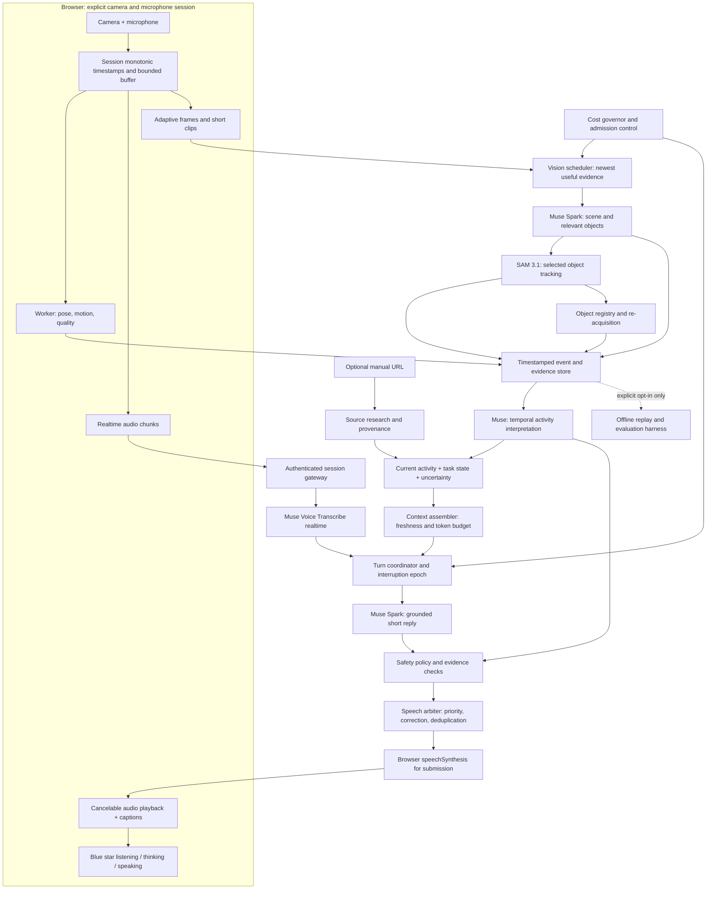

# Glint: real-time multimodal task companion

October 28, 2026 · Proposed architecture and release gates, not an implemented integration or a performance claim.

Revision 2 incorporates the supplied design review: explicit memory/evidence contracts, object re-acquisition, local interruption, safety, cost control and replay evaluation. The review's Meta-only hackathon restriction is adopted as a conservative submission design constraint; official competition eligibility rules have not been supplied or independently verified.

## 1. Product decision

Build the best companion for **doing a hands-on task together**: open the camera, speak naturally, and receive useful guidance grounded in what is happening over time. Keep the blue star, uncluttered interface, camera controls, and voice control beside the text box. A manual/product URL is optional in the top right. Do not require a task-name, version, or questionnaire before conversation starts. Ask one essential question only when ambiguity would materially change the guidance.

“Better than Gemini Live” means a demonstrated advantage on this task-coaching workflow, while matching conversational responsiveness. It does not mean outperforming Gemini on every subject. Gemini Live already offers camera/screen conversation; its API documents continuous audio, native audio responses, and interruption handling. These are a competitive baseline, not differentiators we can claim to have invented. The consumer app and developer API must be evaluated separately. [Google product help](https://support.google.com/gemini/answer/15274899), [Live API capabilities](https://ai.google.dev/gemini-api/docs/live-api/capabilities).

Our proposed advantage: temporal activity understanding + relevant-object tracking + source-grounded task memory + selective, timely coaching. More models or more frames alone do not establish that advantage.

## 2. Honest starting point

The existing local prototype has ordered camera frames, automatic background Muse observations, local pose events, a bounded buffer, streamed text, local microphone endpointing, uploaded utterance transcription, browser speech synthesis, and interruption/cancellation controls. Current background observations target six-second intervals while idle and carry up to six frames from eight seconds. This cannot establish that every fast action was seen.

SAM, a persistent Meta realtime transcription connection, streaming provider TTS, production account isolation, and comparative live accuracy/latency qualification are still missing. Fixture tests demonstrate application behavior, not real-world model quality. See [current implementation evidence](TEST_REPORT.md) and [visual awareness](VISUAL_AWARENESS.md). This plan supersedes conflicting future recommendations in older architecture documents; it does not rewrite historical test evidence.

## 3. Architecture



Two independent lanes are essential. The voice lane must not wait for a SAM clip or manual download. The vision lane updates shared context asynchronously; a question uses the freshest valid evidence available. If evidence is insufficient, acknowledge uncertainty and obtain a fresh observation rather than inventing an action.

### Model and component choices

| Responsibility | Initial choice | Decision rule |
|---|---|---|
| Conversation, scene understanding, activity reasoning | Muse Spark 1.3 Standard | Default; qualify image/video capability, accuracy and latency with actual account access |
| Object masks and tracking | SAM 3.1 | Activate only for relevant objects and demonstrated benefit over Spark alone |
| Live hearing | Muse Voice Transcribe realtime | Replace upload-after-utterance path; retain file transcription as explicit fallback |
| Immediate local events | Existing MediaPipe worker | Fast pose/motion cues; not a general activity classifier |
| Spoken output | Browser `speechSynthesis` for the submitted build | No external TTS model API; provider streaming TTS is a post-hackathon experiment |
| Difficult planning or source conflicts | Optional Muse Wonder | Off the live critical path; enable only if measured improvement justifies added delay/cost |

Meta lists Spark/Wonder as multimodal-input, text-output models and Voice Transcribe as transcription. Do not treat this stack as a native end-to-end speech-to-speech API or promise Meta-generated speech. Do not use Contributor mode by default for private camera sessions. Standard mode's no-training policy is not a zero-retention guarantee. [Model capabilities](https://dev.meta.ai/docs/models), [pricing and data-use modes](https://dev.meta.ai/docs/pricing-rate-limits).

## 4. Seeing activities, not just objects

1. Capture locally at normal preview rate. Keep a short, byte-capped rolling buffer; preview FPS is separate from paid model inference FPS.
2. Run lightweight local motion/quality/pose checks without blocking the UI. Preserve pre-action, action, and post-action samples so quick transitions are not reduced to one still.
3. Spark establishes the scene, likely task, relevant objects, and uncertainty. It selects a small number of useful tracking concepts such as bowl or spoon.
4. SAM follows those objects within a bounded clip. Parse masks/boxes into track observations. Derive motion and proximity features as evidence, not definitive actions.
5. Spark compares ordered visual evidence, tracks, previous observations, conversation, and the current task step. It produces a structured activity hypothesis with evidence references, time range, confidence and meaningful changes.
6. Update task memory and optionally speak. “The spoon is moving inside the bowl” supports stirring; it does not prove ingredients, cooking temperature, or task completion.

Meta explicitly describes the Spark-to-SAM pairing. SAM accepts a short concrete-object prompt and returns geometry; it is not the conversational activity interpreter. Separate object types can require separate requests. Its IDs are reliable within a response, with limitations at exits/occlusion; never assume one global identity across clips. [Segmentation guide](https://dev.meta.ai/docs/media-segmentation), [output and tracking constraints](https://dev.meta.ai/docs/sam/reading-segmentation).

**SAM feasibility gate:** compare hosted short-clip processing with a separately evaluated GPU deployment before choosing a live operating cadence. Verify supported encoding, frame indexing, first-result latency, total latency, billing minimums, mask decoding and rate limits. A streamed segmentation response does not itself guarantee live-speed inference. If SAM cannot meet the freshness budget, keep it as an asynchronous refinement and continue Spark-only live observation. Measure cross-clip association separately and retain uncertainty after occlusion.

Start with bounded adaptive sampling: roughly one scene sample/second, short denser bursts around motion, and a proposed 8–12-second local buffer. These are experimental settings, not a universal fixed upload rate. Send only the useful subset that fits latency, quality, bandwidth and cost limits. Benchmark fast gestures, small objects and occlusion before increasing coverage claims. Do not upload full-rate video by default.

Suggested observation contract:

```ts
type Observation = {
  sessionEpoch: number;
  evidenceIds: string[];
  capturedFrom: number;
  capturedTo: number;
  activity: string | null;
  confidence: 'low' | 'medium' | 'high';
  relevantTracks: { clipId: string; objectId: string; label: string }[];
  changes: string[];
  missingEvidence: string[];
  proposedSpeech: string | null;
};
```

Model confidence is an uncalibrated estimate until evaluated. Never infer gender, identity or intent as a prerequisite to helping someone. Separate observed, user-reported, inferred and source-derived facts. No automatic task completion from a mask or a gesture.

## 5. Natural conversation and proactive behavior

Use an authenticated browser-to-backend WebSocket for audio/control and a backend-to-Meta realtime ASR connection. Keep provider credentials on the backend. Begin with paced mono PCM supported by the documented ASR protocol; treat partial transcripts as replacements and finalize at the provider's completed-turn event. Handle the documented session lifetime with a controlled reconnect. WebRTC is an optional later transport if mobile/network evidence warrants a media gateway; it is not required merely to call a WebSocket ASR API. [Meta realtime ASR](https://dev.meta.ai/docs/speech-to-text).

For the submitted build, stream short Muse text phrases into cancelable browser `speechSynthesis`. External streaming TTS is deferred until after the hackathon and a provider evaluation. Browser voices vary by device and may be OS/network-backed; prefer an available `localService` voice, disclose fallback behavior and do not claim that every browser voice is offline. Spoken output should match visible captions. Browser boundary events are not uniformly reliable: retain a conservative delivered-prefix estimate and an explicit interrupted-reply state rather than claiming exact word-level delivery.

State machine: `idle → listening → processing → speaking`, with camera observation running independently. Speech onset immediately stops playback locally, invalidates the previous reply epoch and cancels queued work. ASR then determines the new turn. Echo cancellation, speakerphone leakage, quiet speech and false interruptions require device tests.

Priority: stop/privacy controls → user speech → requested answer → useful proactive observation → background research. Reserve foreground provider capacity. At most one active job per lane, bounded concurrency per session, and no growing FIFO of old clips. Replace stale pending evidence; reject results from old epochs or task revisions. Cancellation may not prevent provider billing.

On camera start, greet once after a stable observation. Hand raises can receive one quick acknowledgement. General activity changes should receive contextual comments when useful, not constant narration. Suppress repetition and low-confidence claims; let the user choose quiet or coaching mode. Do not interrupt the user with routine observations. Camera-off clears visual buffers/jobs/context; ending voice stops microphone and playback. Explain these states through small controls, not a wall of setup text.

## 6. Memory and instruction grounding

Maintain three scopes: seconds of ephemeral visual evidence, a compact session activity/event history, and an opt-in durable task record. Store current step, prerequisites, source version, uncertainty, unresolved questions and progress provenance. Long context alone is not a memory strategy.

For an optional URL, research the authoritative source and extract a task graph with citations. Ask for confirmation only when product/version ambiguity matters. Treat web/manual text as data, never agent instructions. Keep source-derived advice distinct from general suggestions. Do not block an ordinary conversation while research runs. Preserve safe URL validation and isolated parsing; do not add unrestricted backend fetching.

## 7. Reliability, privacy and operating cost

Retain React/Vite and Node 24/TypeScript initially. Add the persistent session gateway, provider adapters and a bounded scheduler before considering microservices. Use PostgreSQL for opt-in task records and durable session metadata; add cross-instance ownership/leases when scaling beyond one process. Keys remain ephemeral with TTL and deletion on disconnect; reconnect may require reentry. Do not persist media, transcripts or masks by default. Never put keys in frontend environment variables or telemetry.

Public release requires HTTPS, account ownership checks, CSRF/origin enforcement, rate limits, isolated sessions, explicit media permissions, deletion controls and tested failure recovery. Stop controls must work locally even if the server is unavailable. Degrade visibly: voice-only, text-only or vision paused; never simulate a successful live observation.

Instrument timing, counts, byte sizes, cancellation, errors and provider usage without private content. Separate voice, scene analysis, SAM and research budgets. Reserve estimated cost before dispatch, reconcile actual usage, stop background work before consuming the foreground allowance, and expose a simple session budget. Include TTS, hosting and GPU costs. Obtain current token/frame/audio rates and minimum billable units from the provider; do not invent a per-minute price from text-token rates. The prototype's 100-dispatch cutoff needs a budgeted replacement before long sessions. [Current provider pricing](https://dev.meta.ai/docs/pricing-rate-limits).

## 8. Success criteria and a fair Gemini comparison

These are proposed engineering gates, **not measured results or promised SLAs**. Measure on defined devices and network profiles; publish p50/p95 and failures, not just a successful demo.

| Measure | Initial acceptance target |
|---|---|
| User speech onset to local playback stop | p95 ≤100 ms on qualified devices, measured from annotated onset; release blocker if unmet |
| End of user utterance to first meaningful spoken answer | p50 ≤1 s; p95 ≤2 s for simple grounded questions |
| Visible action change to correct contextual response | p95 ≤3 s on the qualified activity set |
| Selected local stable gesture detection | p95 ≤500 ms after the gesture meets stability criteria |
| Qualified activity-event precision / recall | ≥95% / ≥90%, reported by activity and visibility condition |
| Unsolicited incorrect corrections | ≤1 per 30-minute qualified session |
| Supported instruction claims | ≥95% supported by correct source passages on held-out tasks |
| Stability | 60-minute foreground phone sessions without crash, unbounded queues or loss of stop controls |

Time every stage: capture, queue wait, ASR final, model first token, TTS first audio and actual playback. Action latency starts at annotated action onset, not when a delayed clip upload finishes. Report occluded/unobservable cases separately rather than counting confident guesses as successes.

Build a held-out set across cooking preparation, desk assembly and simple crafting, with quick actions, lookalike objects, changed order, interruptions, silence, poor lighting and occlusion. Begin with one narrow task family for release. Use independent activity labels and blinded output scoring; include enough participants and trials to estimate uncertainty, with sample size set from a pilot.

Run three comparisons: (A) Spark-only versus Spark+SAM ablation; (B) controlled API benchmark with matched inputs when supported; (C) live consumer-product task sessions against the currently available Gemini Live version, recording version/date, device, network, task and prompts. Do not infer consumer-app internals from API frame-rate documentation. Randomize order and use equivalent repeated scenarios rather than trying to share one camera unfairly.

The superiority gate: a predeclared primary task-success score improves by at least 10 percentage points with a paired 95% confidence interval excluding zero; correctness and interruption quality meet the absolute gates; voice latency is no more than 250 ms worse at p95 than the measured baseline. Track user-rated helpfulness and cost separately. If the gate fails, describe the measured strengths without claiming “better than Gemini Live.”

## 9. Build sequence and go/no-go decisions

| Stage | Concrete deliverable | Exit evidence |
|---|---|---|
| 0. Establish baseline | Timing instrumentation and a small consented real-device evaluation of the current app | Actual live access, stage latencies, missed actions, costs and failure categories recorded |
| 1. Fix the conversation loop | Realtime ASR adapter, browser phrase playback, conservative delivery tracking, local barge-in handling | Voice targets met; runtime-provider inventory, reconnect, mute and stop tested on phone and desktop |
| 2. Add temporal perception | SAM adapter/parser, relevant-object selection, bounded clips, activity evidence contract | Spark+SAM improves held-out action understanding enough to justify latency/cost; otherwise keep optional |
| 3. Add task coaching | Source-grounded task memory, evidence-based change policy, quiet/coaching controls | Correct step continuity, citations, useful interventions and low false corrections |
| 4. Qualify public operation | Account isolation, durable state, budgets, retention/deletion, load/soak tests | Security and operational gates pass; no prototype-only storage assumptions |
| 5. Compare and tune | Independent Gemini comparison and ablations | Superiority gate met before making comparative marketing claims |

Implementation map: evolve `src/microphone.ts` and `src/speech-queue.ts` for streaming voice; retain `src/camera.ts` and local worker but add bounded clip encoding; add a SAM provider/parser beside `server/agent-provider.ts`; split orchestration responsibilities out of `server/engine.ts` into session coordinator, vision scheduler and evidence store; extend shared schemas before wiring UI behavior in `src/CompanionHome.tsx`. Keep fixture/demo/live labels and existing stop/cancellation guards. Names for new modules are proposals, not files already present.

Update the test report after each material implementation. Validate parser behavior and stale-result races deterministically, then run real-model/device evaluation. Source checks and fixture tests alone cannot close model-quality gates. No paid provider calls, SAM integration, application changes or comparative benchmark were performed to produce this plan.

**First implementation priority:** measure the current live baseline, then complete the realtime voice loop. In parallel at the design level, qualify SAM clip latency and its incremental activity-recognition value. Release only the task scope supported by evidence; expand after the same gates pass.

## 10. Submission runtime boundary

This is the required inventory for the proposed submitted build. It is an architectural allowlist, not proof that each route is implemented or that contest rules permit every local model. Audit deployed network traffic and obtain the actual rules before claiming compliance. In particular, the existing non-Meta local MediaPipe model needs an explicit eligibility decision; disable it for submission if local third-party inference is disallowed. Browser speech is a platform API, but any exception for OS-backed services also needs confirmation.

| Runtime operation | Provider / execution | Submission policy |
|---|---|---|
| Scene checks, activity reasoning, dialogue, manual summarisation | Meta Muse Spark Standard | Allowed design path; all semantic model processing stays here |
| Selected-object segmentation | Meta SAM 3.1 | Allowed design path, subject to budget/freshness gates |
| Live/file transcription | Meta Muse Voice Transcribe | Allowed design path; no browser recognition service fallback |
| Model availability validation | Meta model-list API | Server-side authenticated request |
| Grounded source research | Meta built-in search tool | No separate non-Meta summariser or embeddings API |
| Manual/PDF retrieval | Authoritative source via controlled fetch, if needed | Network retrieval only; parser/OCR boundaries audited; no external inference |
| Spoken playback | Browser/OS speechSynthesis | No developer-configured TTS model endpoint; qualify local voice availability |
| Pose inference | Bundled local MediaPipe | Existing prototype only until local-model eligibility confirmed |
| Motion/quality checks, PDF text extraction | Local deterministic code | No remote inference; sandbox untrusted parsing |
| Wonder escalation / external TTS / hosted embeddings | Meta optional / external services | Disabled for initial submission; reconsider separately after evaluation |

Fail closed on unknown model destinations. Record provider, operation, model ID, usage and timings without recording keys or private content. No new external fallback should activate silently when Meta fails.

## 11. Evidence, time and memory contracts

### Time and freshness

Capture timestamps use `performance.now()` relative to a session origin. Every evidence item carries `sessionId`, `clockEpoch`, `sequence`, `capturedStartMs`, `capturedEndMs`, `receivedAtServerMs` and `evidenceId`. Audio sample counters map to that same client timeline; detect audio-clock drift. Never order camera evidence by server arrival time.

At connection, estimate offset using several ping exchanges and the lowest-round-trip sample; retain RTT-derived uncertainty. Refresh periodically. Use monotonic server time for queue durations, translating client times only with the current offset estimate. Browser reload creates a new clock epoch; reconnect retains it only if the original monotonic origin survives. Never merge epochs without an explicit mapping. If clock uncertainty exceeds 250 ms, do not make tightly timed current-scene claims until resynchronised. The threshold is proposed and must be qualified.

Freshness is checked both before prompt assembly and before speech playback. Age is based on capture time plus timing uncertainty, not inference completion. The oldest frame supporting a present-tense claim must satisfy its TTL; old frames may support explicitly historical statements.

| Claim type | Proposed maximum evidence age | Expiry behavior |
|---|---|---|
| Safety-relevant visible condition | 2 seconds | Request fresh evidence or state the limitation; freshness alone never establishes safety |
| Current action / object position | 3 seconds | Fresh fast-path observation or brief uncertainty response |
| Current step with visual support | 15 seconds | Refresh or answer only from clearly attributed user/task history |
| Historical action or sourced instruction | No live-frame TTL | Cite its time/provenance; never describe it as current visibility |

Each referenced evidence item must exist, belong to the session, match the task revision and have an allowed age. Evidence expiry during generation invalidates dependent current-scene statements. One bounded refresh is allowed when budget permits; no indefinite paid retry loop. Safety checks requiring nonvisual measurements remain unanswerable from images even when fresh.

### Explicit task state

```ts
type StepStatus = 'not_started' | 'in_progress' | 'done_claimed_by_user'
  | 'done_observed' | 'blocked' | 'uncertain';
type Provenance = 'user' | 'vision' | 'source' | 'system';
type StepTransition = {
  id: string; stepId: string; from: StepStatus; to: StepStatus;
  provenance: Provenance; evidenceIds: string[]; reason: string;
  atSessionMs: number; clockEpoch: string; expectedRevision: number;
};
type TaskState = {
  taskId: string; revision: number; sourceVersion: string | null;
  currentStepId: string | null;
  steps: { id: string; prerequisites: string[]; status: StepStatus;
    acceptanceCriteria: string[]; requiresUserConfirmation: boolean }[];
  transitions: StepTransition[];
  unresolvedConflicts: { stepId: string; claimIds: string[] }[];
};
```

Apply transitions atomically with revision checks and idempotent IDs. Source instructions define criteria but do not prove execution. `done_observed` requires explicit, task-qualified visual criteria and valid evidence; it is a proposed future state, not permission to bypass the prototype's user-confirmed progress. Safety-critical completion requires an appropriate measurement or confirmation, never appearance alone.

If the user says “done” while vision appears inconsistent, preserve both claims, mark the step `uncertain`, record the conflict and ask one focused clarification. Do not silently override the user or advance a dependent step as verified. A user can explicitly continue with user-reported status where appropriate; unresolved safety prerequisites remain blocked. Undo invalidates dependent completion and preserves the audit trail. A conflict resolved by the user remains user-reported unless separately observed.

### Context assembler

Before each reply, build a bounded context from instruction/safety policy, task revision, current step, valid evidence, selected source passages and a short conversation tail. Start with a proposed 12,000-input-token ceiling, explicit per-section allowances and a reserved output budget; tune from measured usage. Preserve policies, conflicts and provenance before optional history. Drop expired observations and redundant tracks first; never silently truncate a prerequisite or manufacture missing evidence. Include assembled token estimates and omitted-evidence counts in content-free telemetry.

## 12. Object continuity and two-speed reasoning

Maintain an ephemeral Object Registry with `registryId`, label, Spark appearance description, last bounding box, last-seen time, clip-local ID references, association confidence and state `visible | occluded | lost | ambiguous`. Associate new clip tracks using time, location, appearance and task context. A plausible match is still a hypothesis; two similar screws must not be silently merged. Age out lost entries. Require re-acquisition after prolonged absence/full occlusion, and do not map objects across users or sessions.

If Spark selects the wrong object, support “track this one” with a held-up/pointed object and an optional tap on the preview. Resolve the intended object before replacing the track; ask a brief clarification if pointing is ambiguous. Track hand/object association as spatial evidence rather than identity certainty.

The **fast path** uses fresh Spark evidence and existing valid tracks without waiting for new SAM results. Local motion/pose cues trigger or prioritise observations. A low-cost Spark scene check runs on a budgeted schedule; expensive temporal interpretation runs on meaningful changes, uncertainty/conflict, a user question or a bounded periodic refresh. Cheap does not mean free or guaranteed fast: measure each operation.

The **refinement path** runs SAM asynchronously on selected clips. New evidence may confirm the earlier answer or produce a `correction` utterance. Speech candidates have `kind: answer | acknowledgement | coaching | correction | hazard`, evidence IDs, task revision, freshness deadline and `supersedesUtteranceId` where relevant. Corrections must explicitly explain the changed claim, pass freshness/safety checks, and avoid oscillating between uncertain hypotheses. The three-second activity target applies to qualified fast-path events, not every SAM refinement; report SAM latency and correction frequency separately. Refinements that consistently arrive too late should be disabled, not advertised as realtime.

## 13. Local stop, bystanders and safety policy

Stopping playback must never wait for a server transcript. Local echo-aware VAD immediately cancels browser speech and queued phrases on likely user speech onset; explicit mute/end/stop controls act synchronously. A worker-based local stop-word spotter is an optional additional intent signal only after accuracy, resource use and local-model eligibility are qualified. Energy detects onset, not the word “stop”; do not claim keyword recognition without a tested spotter. When ASR returns, confirm the intended command and update state. Temporary false-positive silence is preferable to ignoring a real interruption, but measure both.

V1 does not promise speaker identity or bystander diarization. During playback, use acoustic echo cancellation and an adaptive onset threshold to reduce self-triggering; do not discard all overlapping speech or assume loudness proves proximity. Preserve a short bounded pre-roll for a possible interruption. Quiet-user and distant-speaker tests must guide tuning. Provide press-to-talk as an explicit fallback in noisy/shared environments. If speaker intent is unclear, ask before changing task state.

The Safety Policy checks proposed answers, interventions and corrections before the speech arbiter. Candidate hazards include hot surfaces, sharp tools, raw-food handling, allergens and electrical work; a detected pattern prioritises evaluation, not an unverified alarm. Never claim internal temperature, absence of allergens, electrical isolation or safe doneness from appearance. Ask for an appropriate measurement, label or explicit confirmation. Block instructions that depend on unverified safety prerequisites. Routine uncertainty stays conversational; a credible time-sensitive hazard can interrupt coaching. Even urgent speech must yield to the user's local stop control. This is assistance, not a reliable hazard detector; test missed hazards and false alarms separately.

## 14. Cost governor control loop

Define user session cap `B`, rolling 60-second spend ceiling `M`, foreground reserve `R` and per-job worst-case reservation from bounded inputs/output limits and current billing units. At admission, committed usage plus outstanding reservations plus the next job must fit both the rolling and session budget while protecting `R`. Include SAM minimum billable units and duplicate-object requests. Unknown usage stays reserved conservatively; reconcile on completion without double-counting retries/cancellations.

Evaluate after each dispatch/completion and once per second. Proposed degradation states use the greater of actual-plus-reserved rolling spend and projected next-window demand relative to `M`:

| Pressure | State / action |
|---|---|
| Below 60% | Scene-check ceiling 1/second only if latency/rate limits allow; event-driven deep reasoning |
| 60–75% | Reduce scene-check ceiling to 1/3 seconds; retain useful event bursts within reservation |
| 75–85% | Disable new SAM work; retain Spark fast path and foreground voice |
| Above 85% or reserve threatened | Pause paid background vision; explain reduced awareness briefly |
| Foreground request exceeds remaining cap | Do not dispatch; offer text/local controls and explicit budget adjustment |

Use hysteresis: recover one level only after pressure stays below that level's entry threshold minus 10 percentage points for 30 seconds. Rate-limit errors trigger immediate backoff independently of spend. Targets and thresholds require calibration; reducing cadence must not silently retain a freshness claim. Budget adjustment requires explicit user choice; no silent cap increase. Apply the same policy to replay runs so evaluation cannot create uncontrolled costs.

## 15. PDF sources and replay evaluation

Manual research must handle PDFs as well as HTML. Prefer Meta-grounded source discovery; fetch an identified authoritative PDF only through a controlled, size/page/time-bounded retrieval service with redirect revalidation and private-network blocking. Parse in an isolated worker, reject active/encrypted content that cannot be safely handled, and never execute embedded JavaScript, attachments or links. Preserve page numbers, document version/hash and passage offsets. Treat extracted text as untrusted data. Image-only pages may use Meta visual understanding under budget, or ask for a readable source; no hidden external OCR/model fallback. Retrieval/extraction failures should not invent a manual summary.

Add a replay/eval harness consuming versioned session bundles: timestamped frames/audio, transcript revisions, observations, object associations, task transitions, speech candidates, delivery estimates, configuration/model versions and usage. Raw bundles require separate explicit recording consent, participant/bystander handling, encryption, access limits, a declared retention deadline and deletion; recording remains off by default. Store outside ordinary telemetry and never commit private recordings to the repository.

Replay supports deterministic local scheduling/parser tests with recorded provider outputs, and separately labelled paid inference runs using the same evidence for Spark-only/Spark+SAM ablations. Redact keys and private URLs. Freeze evaluation labels before tuning; keep held-out sessions separate. Offline replay cannot establish microphone echo behavior, actual live network timing, browser interruption latency or user experience; retain real-device tests for those gates.

### Revision 2 implementation gates

Before Stage 1 exits: confirm contest/runtime eligibility, verify browser voice behavior, implement local stop timing instrumentation and define the task/evidence schemas. Before Stage 2 exits: test stale results, clock drift/reconnect, wrong-object selection, occlusion and late corrections. Before Stage 3 exits: test user/vision conflicts, PDF provenance, safety prerequisites and context truncation. Before public release: validate spend reservation/degradation/recovery, bundle consent/deletion and bystander/noisy-room behavior. These additions are specifications only; no implementation or live validation is implied.
