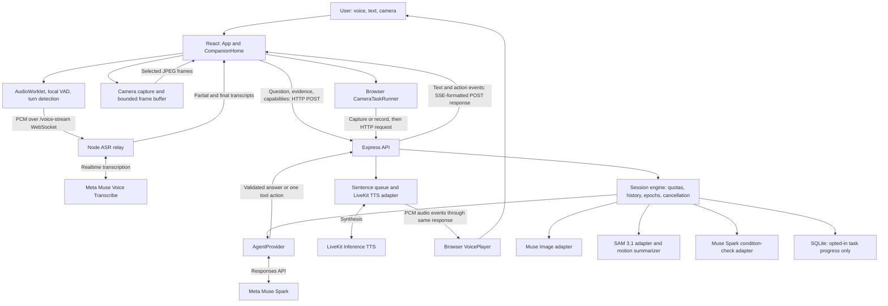

# Glint — implementation architecture

Reviewed 3 November 2026 against main at `e29de4e`. This is a source-based architecture review, not a live-provider accuracy evaluation. Review follows the application entry points and the conversation, camera, speech, tools, session and storage paths. It does not claim that every line of every test, stylesheet and historical prototype has been audited.

## System shape

Glint is a React browser application backed by one Node.js/Express process. It is a modular monolith with browser-side media capture and tool coordination, server-side session control and provider adapters, and externally hosted AI models.

The public test URL uses a Cloudflare tunnel to the laptop-hosted process. It is not an independently hosted production service. Render deployment configuration is prepared, but this diagram does not imply a live Render deployment.

## Ownership and module boundaries

| Boundary | Responsibility | Sources |
| --- | --- | --- |
| Browser entry | Main app at `/`; lazy-loaded comparison app at `/livekit` | `frontend/main.tsx` |
| Application shell | Session bootstrap, connection status, key dialog, workspace/task UI | `frontend/App.tsx` |
| Companion orchestration | Conversation, voice lifecycle, camera context, tool results, interruption and settings | `frontend/CompanionHome.tsx` |
| Media input | Camera permissions, bounded stills, MP4 clips; microphone AudioWorklet, VAD and WAV recovery | `frontend/camera.ts`, `frontend/microphone.ts`, `frontend/ml-vad.ts`, `public/voice-capture.js` |
| Local visual events | Optional pose-based visual signals, separate from SAM segmentation | `frontend/visual-awareness.ts`, `public/vision-observer.js` |
| Browser action execution | Validates tool actions, captures evidence, coordinates jobs and one-shot checks | `frontend/camera-task-runner.ts` |
| Browser speech output | Ordered PCM playback, interruption, explicit device voice | `frontend/voice-player.ts`, `frontend/speech-queue.ts` |
| HTTP boundary | Schemas, cookie session, origin/CSRF checks, routes, response streams | `backend/app.ts` |
| Runtime | Environment loading, static/Vite serving, WebSocket upgrades, health and shutdown | `backend/index.ts`, `backend/runtime-config.ts` |
| Session engine | In-memory sessions and keys, provider-call allowance, request deduplication, history and cancellation | `backend/engine.ts` |
| Provider adapters | Meta conversation, transcription, image generation, SAM and condition evaluation | `backend/agent-provider.ts`, `backend/asr-provider.ts`, `backend/image-provider.ts`, `backend/sam-provider.ts`, `backend/condition-provider.ts` |
| Existing checkpoint workflow | Source/task coaching and validated step decisions; separate from the companion tool coordinator | `backend/provider.ts`, `shared/model.ts` |
| Speech synthesis | Provider selection, sentence FIFO, incremental cloud PCM | `backend/tts-kokoro.ts`, `backend/tts-stream.ts`, `backend/tts-livekit.ts` |
| Shared contracts | Validated request/result types, tool definitions, evidence bounds and diagnostic schemas | `shared/` |

## Conversation and voice sequence

1. `/api/session` creates or resumes a private cookie session and returns its view/CSRF token. Refresh does not resurrect a previous active observation epoch.
2. The user connects a Meta key through `/api/key`. The main companion's key is held in server memory; it is not sourced from a server environment fallback.
3. Typed input goes directly to conversation orchestration. Voice input passes through browser audio capture, local speech detection and `/voice-stream` to Meta ASR. The app controls the turn boundary in `PUSH_TO_TALK` mode; it is still hands-free. Bounded WAV transcription is a recovery path.
4. The browser sends the question, selected model, recent evidence and available camera-tool capabilities to `/api/agent/stream`.
5. The engine checks key/model access, freshness, epoch, duplicate request ID, available lane and allowance before dispatching.
6. `AgentProvider` combines conversation history, recent visual/motion context and current input for Meta Responses. Camera-capable turns expose bounded function definitions. Supplied URL research instead exposes provider `web_search`; this is not an always-on Google search service.
7. The provider result becomes a normal answer or one validated camera action. Tool arguments are internal. Camera-tool-capable answers can be buffered until validation rather than forwarding every raw model delta to speech immediately.
8. Normal answer text feeds the sentence queue. LiveKit Inference returns 24 kHz mono audio, aggregated into roughly 120 ms PCM chunks and emitted over the reply response. The browser plays those chunks. Sentence synthesis overlaps with eligible answer generation; sentences themselves are queued in order.
9. A tool action returns without waiting for speech initialization. The browser executes the action and displays its actual result. This is application-managed tool execution, not an unrestricted server agent loop.

The main app does **not** send microphone audio through a LiveKit room. LiveKit supplies TTS here; Meta supplies transcription and the main conversation model.

## Camera and tool paths

Camera capture runs locally while enabled. The model receives selected evidence on requests, not every camera frame continuously. The local ring is bounded to 12 seconds, 32 frames and 4 MiB. Recent conversation evidence is selected and encoded separately.

Background observations are opt-in, off by default, at most once every 30 seconds and at most 20 per page. They yield to voice/work and stop near the call allowance. These are sampled checks, not continuous remote video understanding.

| Tool | Trigger and execution | Model or computation |
| --- | --- | --- |
| `edit_camera_image` | Explicit image request; fresh camera capture or previous generated result; `/api/look-preview` | `muse-image-1.0` with image-generation tool; returned bytes validated |
| `annotate_camera_frame` | Asked to mark an issue/location in supplied evidence; uses validated coordinates on that frame | Muse Spark selects marks; browser overlays them; no SAM request required |
| `track_object_motion` | Requested new movement analysis, object analysis enabled; record a new two-second MP4; `/api/track` | `sam-3.1`, official parser, then local box-center movement heuristics |
| `schedule_camera_check` | One requested check 5–120 seconds later; capture at deadline; `/api/condition-check` | Muse Spark structured verdict: met, not met or uncertain |
| `request_camera` | Required camera is unavailable | Browser prompts user to open camera |
| `cancel_camera_task` | User requests cancellation | Local cancellation and server request abort where applicable |

Default tool selection is model/context-based **within application gates**. Single-word fragments, acknowledgments, status questions, image-in-progress state, permissions and supplied-URL mode can restrict tool availability. The server validates tool arguments and capabilities before returning an action. Legacy manual flows remain: `trackingIntent()` keyword/object matching and the manual look-preview card run when camera tools are disabled.

SAM does not run automatically whenever the camera opens. It analyzes a newly recorded clip, not past unrecorded movement. The browser targets 384-pixel longest edge and 12 fps, without microphone audio. Server validation bounds clip size to 600 KB and validates format/time. Direction is relative to the camera; it is not camera-motion-compensated or persistent tracking across clips.

## Concurrency and cancellation

- Browser media capture, transcription transport and output playback have separate lifecycles. This does not imply unlimited simultaneous model requests.
- Most engine inference operations share one busy lane per session. Image generation has a separate controller/lane; conversation and transcription can run alongside it. The UI bounds queued image follow-ups instead of allowing arbitrary overlapping image jobs.
- `AbortController`, session epochs, request IDs and browser generation tokens prevent stale results from being displayed after interrupt, camera/session changes or reset.
- The engine applies 45-second deadlines to ordinary provider operations and 120 seconds to image generation. Client controls also have bounded pause/reset/announcement waits.
- Scheduled checks use browser timers and depend on the page remaining visible and the camera session remaining valid. They are not durable background jobs.
- Main cloud voice does not silently switch to device voice on failure; device speech remains an explicit alternative. Kokoro is retained as a configurable local backend.

## State, privacy and diagnostics

| State | Location and lifetime |
| --- | --- |
| Camera frames, audio, generated images | Transient browser/server request or session memory; relevant media is sent to the selected external provider |
| Meta key | Server session memory; 15-minute idle / two-hour absolute lease; restart requires reconnect |
| Conversation, active jobs, call allowance | In-memory engine state; 100 dispatches per session; current session capacity 200 |
| Reviewed task progress | SQLite only when opted in; seven-day expiry; excludes keys, conversations and media |
| UI preferences | Browser localStorage; Start Glint entry state uses sessionStorage |
| Diagnostic trace | Bounded content-free browser/server event buffers, timings, IDs and status; structured server logs |

Origin checks, CSRF validation, HttpOnly/SameSite cookies, production HTTPS origin requirements, CSP, private-path blocking and schema validation protect application boundaries. This is device-session isolation, not managed user-account authentication. Logs are not a full transcript recording and cannot alone explain every semantic misunderstanding.

## Separate `/livekit` comparison architecture

`LiveKitPrototype` obtains a restricted, short-lived room token from the same backend, guarded by an access code. A separate agent worker connects to LiveKit Cloud and composes configured STT, an OpenAI-compatible LLM adapter and TTS. The agent identifies itself as voice-only and has no main Glint camera/image/search tools. It has a five-minute prototype limit. Its environment-configured model key is distinct from the main browser BYOK flow.

Sources: `backend/livekit.ts`, `backend/livekit-agent.ts`, `backend/livekit-agent-config.ts`, `frontend/LiveKitPrototype.tsx`.

## Architecture follow-ups identified by review

1. `CompanionHome` and `App` own many concerns. Extract media/voice lifecycle, conversation dispatch and tool orchestration into focused hooks without changing contracts.
2. In-memory sessions/jobs and browser timers constrain deployment to a single process. Durable/shared state and server-side job scheduling require explicit design before scaling.
3. Status-question routing still contains broad word rules. Context-based tool selection is therefore partly constrained by heuristics that need semantic regression coverage.
4. `render.yaml` still selects `codex/livekit-prototype`, although current updates are on `main`. Update the deployment branch when resuming deployment; no deployment was performed during this review.
5. Image-provider instructions are still tailored to outfit/makeup previews despite broader camera-tool descriptions. Clarify the supported image-edit scope before advertising general editing.
6. Existing architecture drawings predate cloud TTS and some camera tools. Use this source-grounded diagram for current discussions; retain old diagrams as historical material.

These are review findings and next-design candidates, not claims that production or live-provider tests have been completed. No runtime changes are part of this document.
