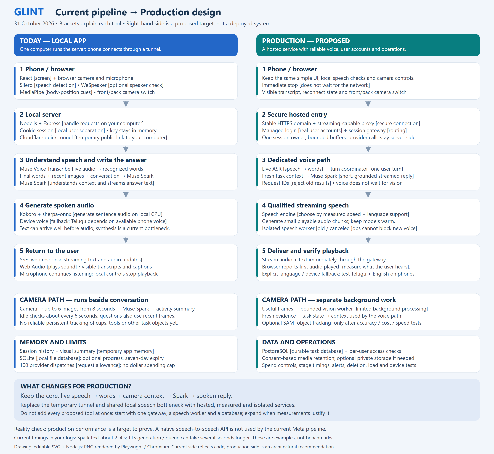

# Glint: current pipeline and proposed production pipeline

31 October 2026. The left side reflects the current code and the phone-to-local-server tunnel used in this session. The right side is a recommendation, not a deployed system.

[Editable SVG](assets/glint-now-vs-production.svg). Regenerate with `node scripts/draw-pipeline-comparison.mjs`.

## Today

Microphone audio streams from the browser through the local Node/Express server to Muse Voice Transcribe. Final recognized words, recent selected camera frames and conversation context go to Muse Spark. Reply text streams back while local Kokoro synthesizes phrases on the computer's CPU. Telugu sentences use device speech fallback, whose language support depends on the phone. If live transcription loses audio or disconnects, the app can fall back to the complete bounded recording.

Camera observations run separately at the browser level, yielding to voice work. Up to six frames from eight seconds go to Muse for recent visual context. The engine uses temporary conversation and visual memory; optional task progress uses SQLite. There is no persistent task-object tracker or managed account authentication.

Current implementation references: `src/CompanionHome.tsx`, `src/camera.ts`, `src/voice-stream.ts`, `server/app.ts`, `server/asr-provider.ts`, `server/engine.ts`, `server/tts-stream.ts`, `server/tts-kokoro.ts`, `server/store.ts`.

## Production target

Keep the core conversation flow. Replace the quick tunnel with a stable domain, HTTPS and a streaming-capable hosted gateway. Add managed user login, durable opt-in task records and enforced per-user access. PostgreSQL is a proposed database choice; its policies support per-user row access, but ownership checks and carefully configured database roles are still required. [PostgreSQL policies](https://www.postgresql.org/docs/current/sql-createpolicy.html).

Give voice a dedicated path and isolate speech synthesis from the request-handling process. Select a speech engine only after measuring first playable audio, CPU capacity, quality and Telugu/English support. Keep it warm, bound its work, discard superseded jobs, and measure browser playback rather than treating text or synthesized bytes as proof that sound was heard. A separate process does not itself make a slow model faster; provision capacity or change the engine based on measurements.

Use bounded background vision work that cannot block voice. Add SAM and object identity/history only if held-out tests show sufficient value for their added cost and delay. Do not make object tracking mandatory for the first public deployment.

For session-only BYOK, keep provider calls and temporary keys server-side after submission, never place keys in durable jobs or the database, and require key reentry after expiry or server failover unless a separate secure handoff is designed. Speech hosting, storage and infrastructure need their own funding; a Meta key does not pay for them.

Before release, qualify end-of-speech-to-audio latency, interruption, lost/repeated words, scene accuracy, per-user isolation, deletion, costs, concurrent sessions and long foreground phone sessions. Set numeric targets before testing; this diagram claims no achieved production latency.

The Meta interface remains a composed pipeline: recognition, Spark reasoning and separate speech output. [Meta model documentation](https://dev.meta.ai/docs/models) and [speech-to-text documentation](https://dev.meta.ai/docs/speech-to-text).

The diagram was drawn with SVG and Node.js, rendered with Playwright/Chromium, and visually inspected. It does not change application code or deploy infrastructure.
