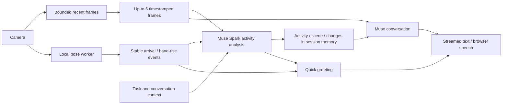

# Glint visual awareness

Camera mode observes changes without requiring a spoken question first. It has two complementary paths:

The local model supports fast visible-pose reactions. General activity interpretation comes from Muse comparing the sequence, prior observation and task context: it is not limited to a hard-coded gesture list. Visual context and local pose events are estimates, not independently verified facts. Low-confidence observations do not produce proactive speech.

## Current scheduling

- Local camera buffering samples about once per second, with brief motion bursts, bounded to twelve seconds/32 frames/4 MB.
- The pose worker receives at most five frames per second, one at a time, at reduced resolution. Reactions require stable visible landmarks across time and rearm/cooldown rules.
- Muse receives at most six chronologically ordered JPEGs from the latest eight seconds. Each image is bounded below 90 KB; the client reduces large images before encoding.
- Background observation starts after initialization and targets one request per six seconds while the conversation is idle. Slow service responses reduce this rate. No backlog accumulates.
- Voice or typed interaction cancels a pending background job and takes priority. Questions receive current frame history and recent activity context.
- Proactive model speech has a eight-second cooldown; unchanged scenes should remain quiet. Local gesture greetings use separate transition/cooldown rules.
- Stop camera terminates the pose worker, clears the frame ring and event history, cancels observation and clears server visual context. Backgrounding and disconnect also stop capture.

The existing session-only key, one-in-flight policy and 40-dispatch allowance apply to automatic camera observations as well as voice/research. Camera mode therefore makes billed requests without waiting for a question. Exhaustion or a provider error pauses visual awareness; there is no unlimited retry loop. Ending voice disables automatic spoken reactions, but a camera left on continues visual observation.

## Runtime and evidence

The local tracker uses pinned `@mediapipe/tasks-vision` 1.2.0 and Google's Pose Landmarker Lite float16 revision 1. `scripts/prepare-vision.mjs` copies the pinned SDK runtime and checks the model hash. The generated runtime is ignored; the model and provenance notice are included. No camera pixels go to Google. Meta receives the selected sequences under the user's connected account. Images, events and activity context are not written to application storage.

Primary references:

- [Meta multiple-image input](https://dev.meta.ai/docs/image-understanding)
- [Meta structured output](https://dev.meta.ai/docs/structured-output)
- [MediaPipe web pose tracking and worker guidance](https://developers.google.com/edge/mediapipe/solutions/vision/pose_landmarker/web_js)

The local worker is tested with an attributed public documentation image. Activity-analysis and browser interaction tests use fixture Meta responses and synthetic camera input. These checks establish wiring and lifecycle behavior, not live Muse action-recognition accuracy. Rapid/off-camera/occluded actions can be missed. No perfect activity recognition, identity/gender inference, continuous full-FPS video understanding or production latency claim is made.
